# Kepler

A theme for [Obsidian](https://obsidian.md) 1.14.5+ on desktop and mobile, built around one idea: **Focus on what you write and read.**

## What makes Kepler different

- **Dark interface, light or dark note.** Sidebars, tabs, menus and the status bar stay dark in both modes. Switching Obsidian to light mode changes only the note area. So you can read on white without the whole window flashing bright.
- **PDF export always uses the light note palette**, whichever mode you export from.
- **Reading-first typography.** Source and reading views use identical margins, so switching between them doesn't move the text.
- **Headings you can tell apart at a glance.** Each level has its own shape, not just its own size.
- **Documented contrast.** Every text colour pair has its WCAG 2.x ratio next to it in `theme.css`, and `tools/check_contrast.py` checks them all, for the default accent and across 580 custom accents. Body text is 4.5:1 or better in both modes, and code syntax colours are 4.5:1 or better on their code background. Syntax also uses shape (bold keywords, italic comments), not colour alone.
- **Built on Obsidian's variables.** Kepler sets Obsidian's own CSS variables wherever one exists, and uses selectors only where none does, so it stays light and survives app updates. Every theme-owned variable is prefixed `--kepler-*`.

## Custom accent
Kepler follows **Settings → Appearance → Accent color**. The colour you pick sets the hue and saturation of every accent detail.

### Blue / Teal (Default Accent)
| Note View (White) | Note View (Dark) |
| :-: | :-: |
| 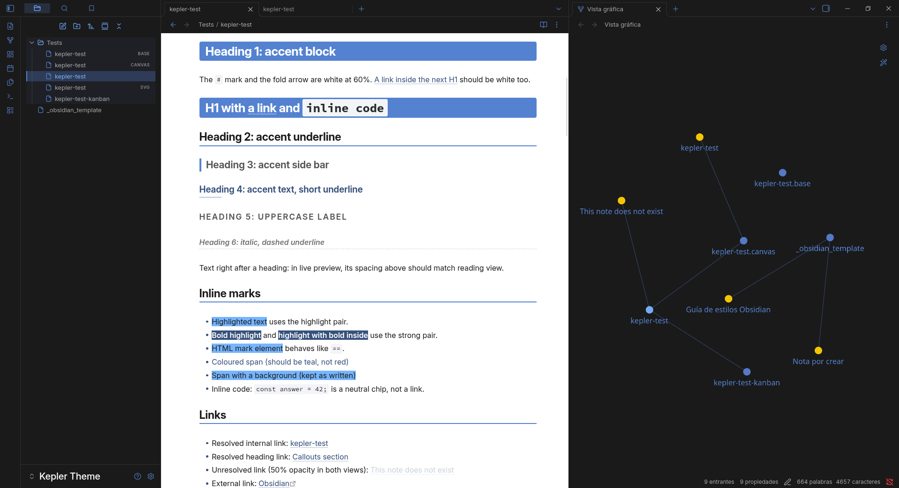 | 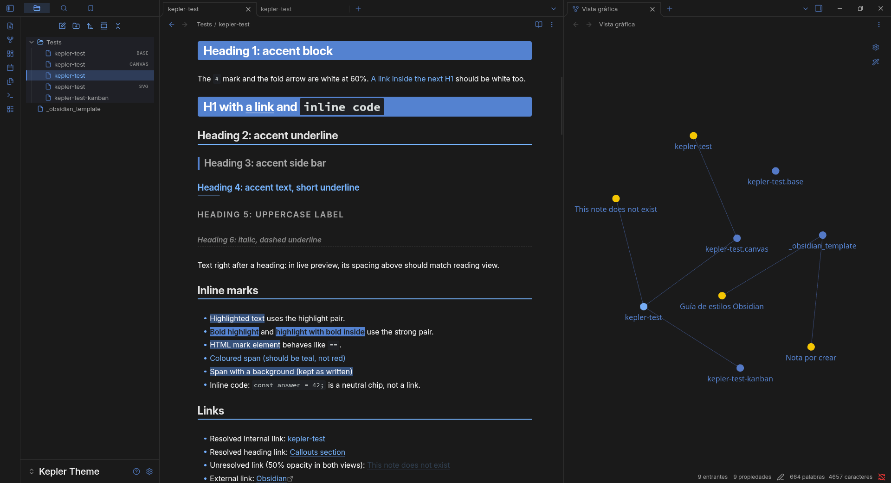 |
| **Code View (White)** | **Code View (Dark)** |
| 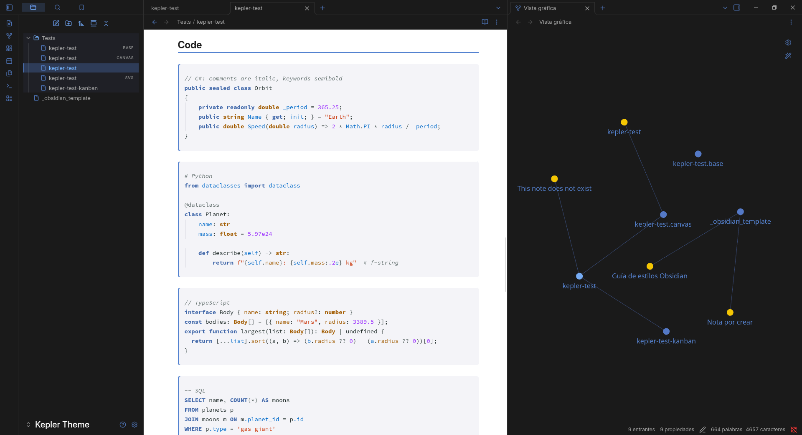 | 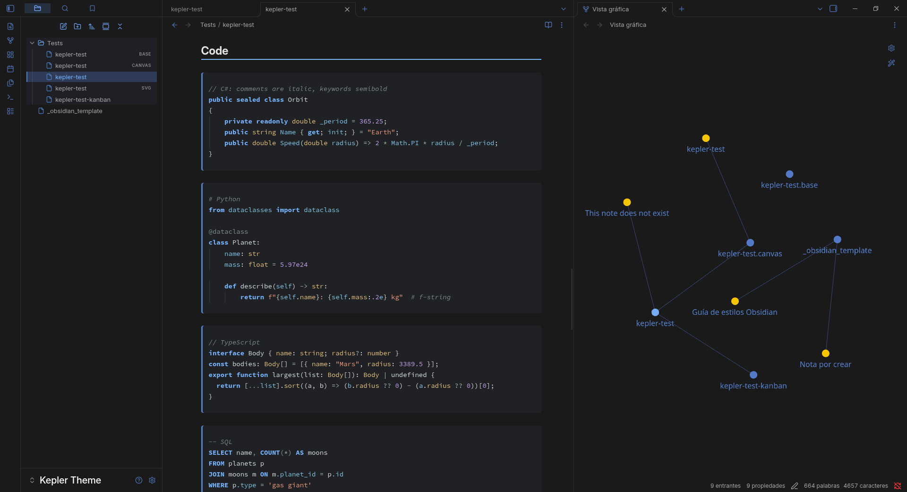 |

---

### Green Accent
| Note View (White) | Note View (Dark) |
| :-: | :-: |
|  | 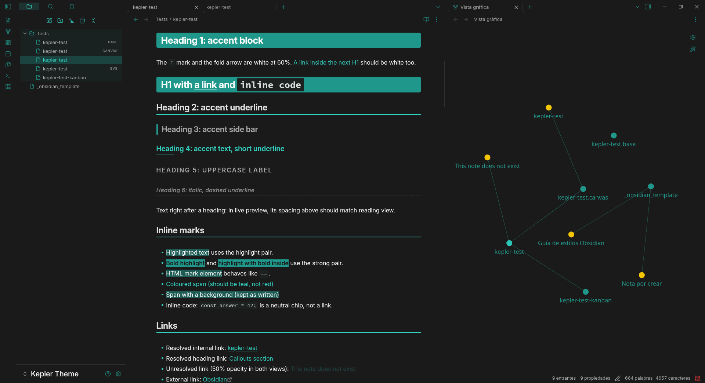 |
| **Code View (White)** | **Code View (Dark)** |
| 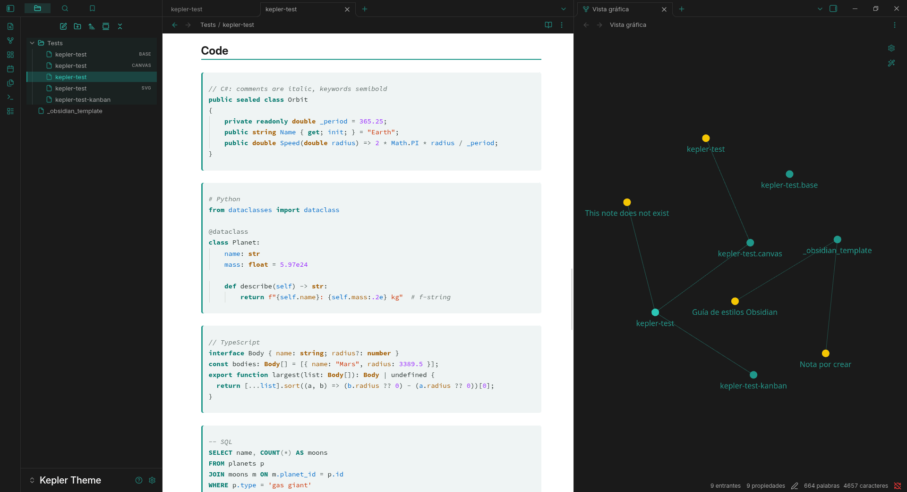 | 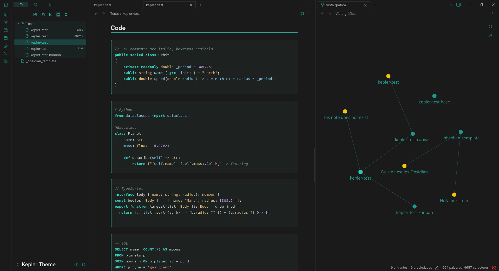 |

---

### Red Accent
| Note View (White) | Note View (Dark) |
| :-: | :-: |
| 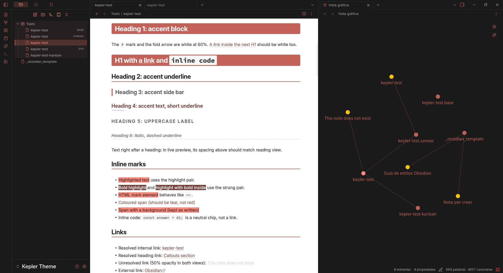 | 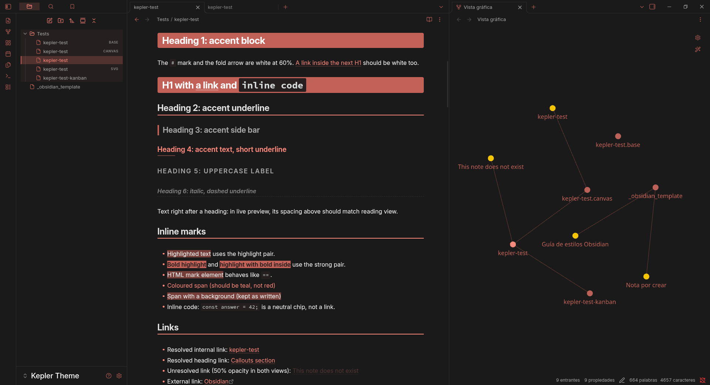 |
| **Code View (White)** | **Code View (Dark)** |
| 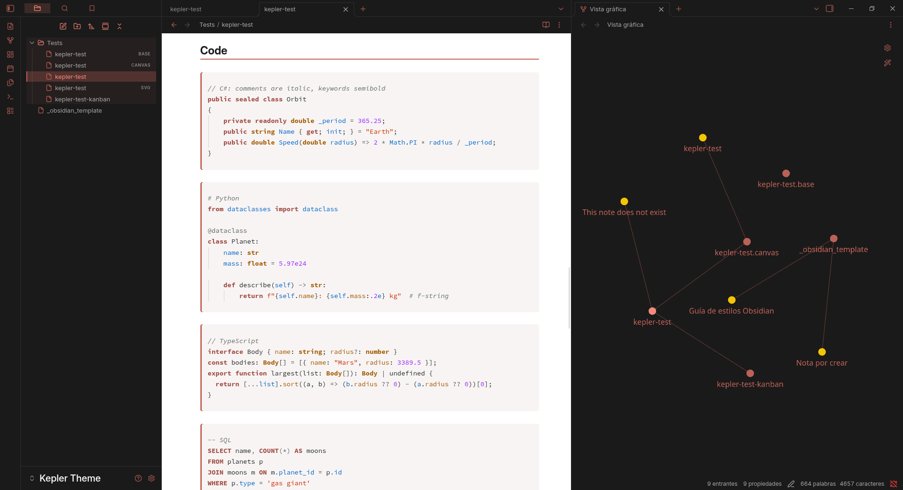 | 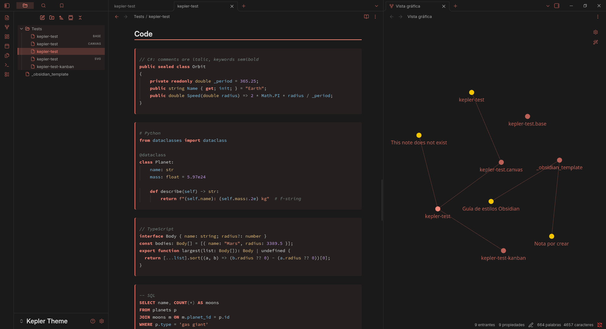 |

---

### Yellow / Orange Accent
| Note View (White) | Note View (Dark) |
| :-: | :-: |
|  |  |
| **Code View (White)** | **Code View (Dark)** |
| 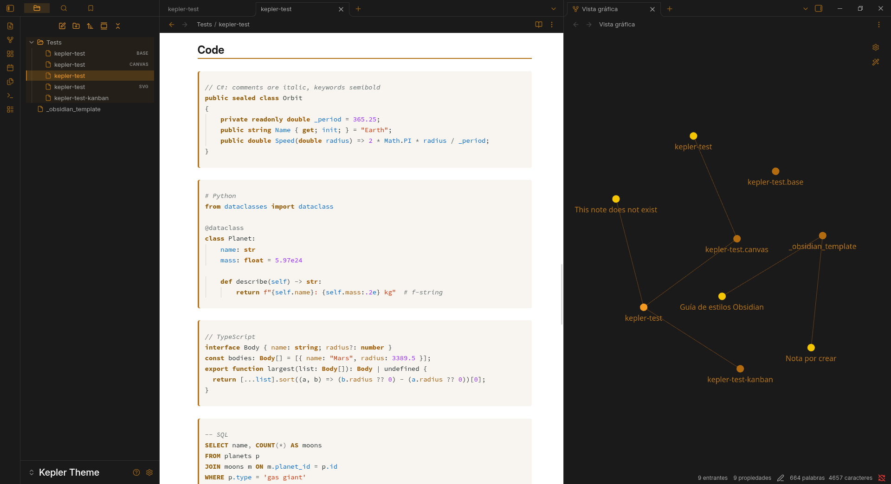 | 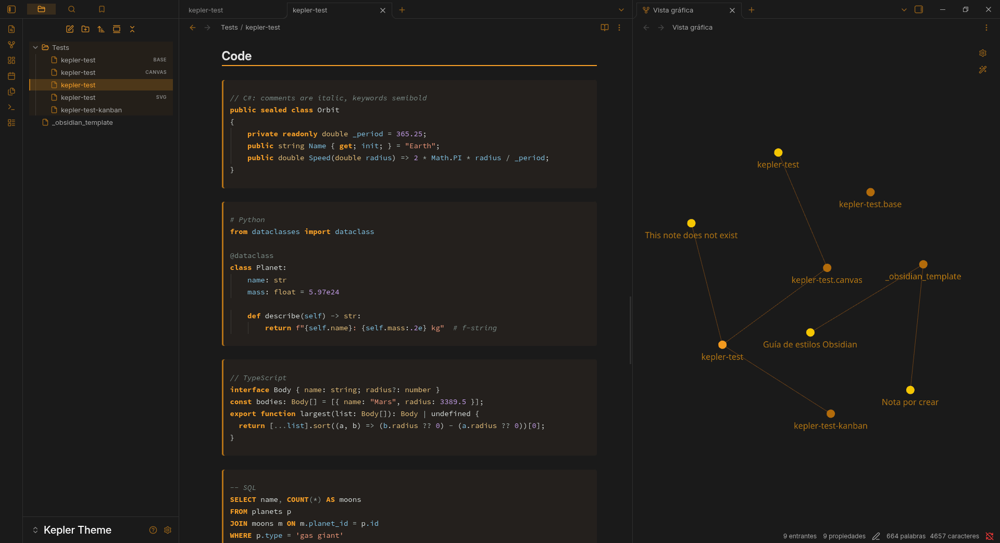 |

## Supported plugins

| Plugin | What Kepler does |
|---|---|
| **Dataview** | Numbered rows and a header rule in `TABLE` views. |
| **Excalidraw** | The active tool uses the light accent with dark icons, in both modes. |
| **Code Styler** | Code blocks follow the note's light/dark palette instead of the dark UI. |
| **Kanban** | Boards follow the note's light/dark palette. Cards are raised above their lanes (lighter in dark mode), lanes alternate two neutral greys, and the add buttons stay readable on hover. |
| **Calendar** | The accent for today, a faint accent tint on weekends, readable other-month days, and theme colours for headings. |

## File explorer

Folders and files get a simple line icon in the accent colour, and the folder that holds the open file is tinted, with its icon in the lighter accent. Rows that already have an icon from Iconize keep theirs. To turn Kepler's icons off, add this CSS snippet:

```css
body { --kepler-tree-icons: none; }
```

## Recommended settings

- **Settings → Editor → Readable line length:** on (for the 720 px column).
- **Settings → Appearance → Show indentation guides:** on. Kepler relies on Obsidian's own guides in the file explorer and tag pane.

## Installation

### Community theme store
1. Open **Settings → Appearance → Themes → Manage**.
2. Search for **Kepler**, then select **Install and use**.

### BRAT
1. Install the **BRAT** plugin from the community plugins.
2. Run **BRAT: Add a beta theme for testing** and enter this repository's URL.
3. Pick **Kepler** in **Settings → Appearance → Themes**.

### Manual
1. Download `theme.css` and `manifest.json` from the latest release.
2. Put them in `<your vault>/.obsidian/themes/Kepler/`.
3. Reload Obsidian and pick **Kepler** in **Settings → Appearance → Themes**.

## License

[MIT](LICENSE) © 2026 Mateu Bennasar Lendinez
