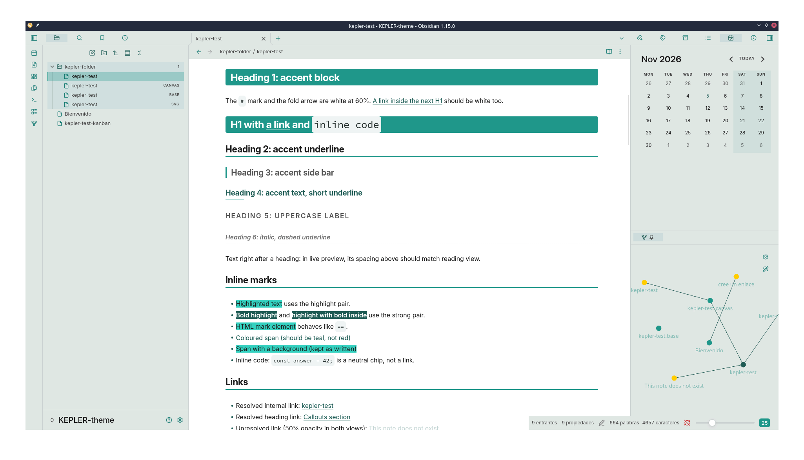
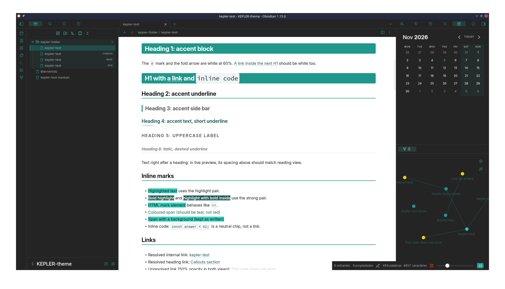
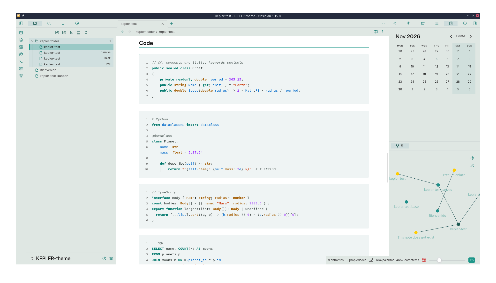
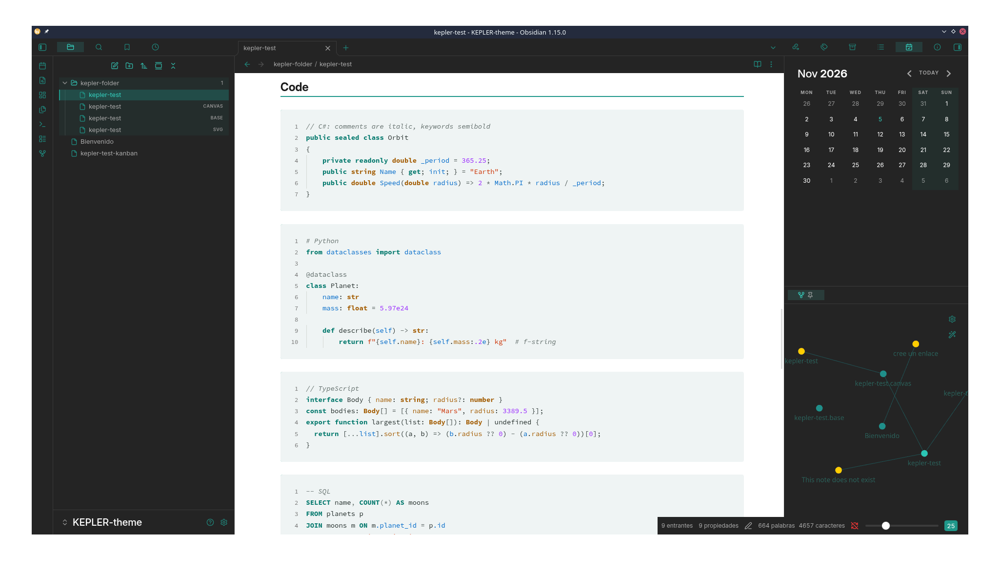
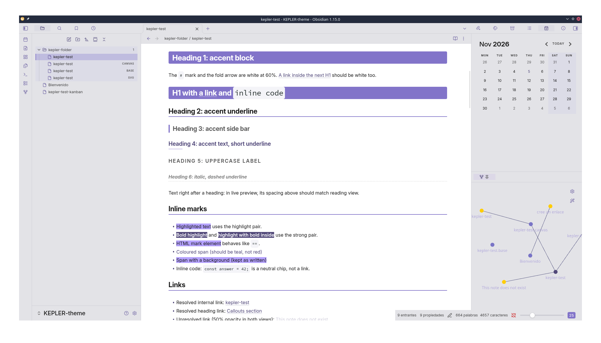
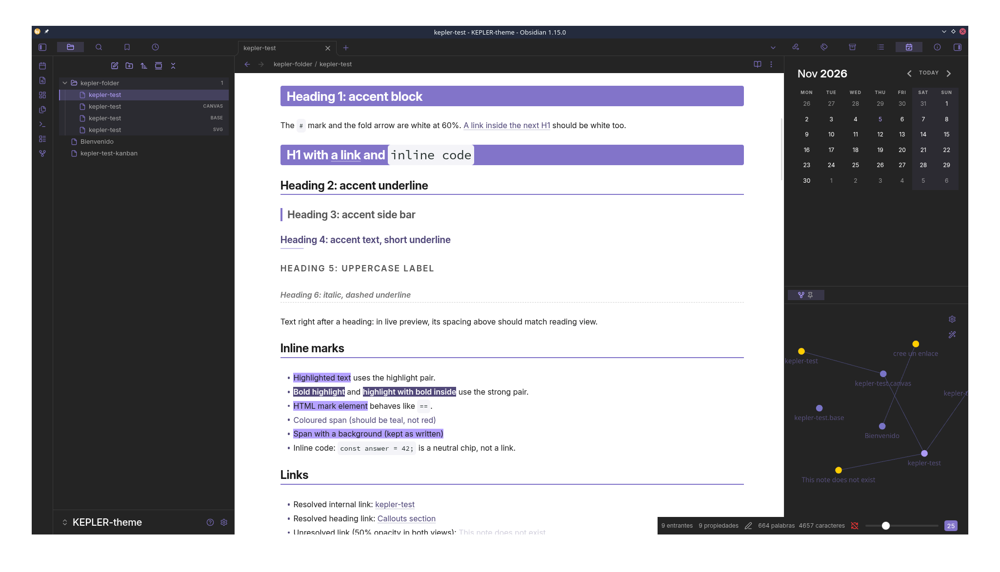

# Kepler

A theme for [Obsidian](https://obsidian.md) 1.14.5+ on desktop and mobile, built around one idea: **Focus on what you write and read.**

## What makes Kepler different

- **Always a light page to study on.** Notes, Kanban boards, Bases, canvas and Mermaid diagrams use the same light palette in both modes. The mode changes only the interface around them: sidebars, tabs, menus and the status bar are dark in dark mode, and in light mode they use light greys, a step darker than the white page and faintly tinted with your accent colour, so what you read stands apart from the interface.
- **PDF export uses the same light palette**, whichever mode you export from.
- **Reading-first typography.** Source and reading views use identical margins, so switching between them doesn't move the text.
- **Headings you can tell apart at a glance.** Each level has its own shape, not just its own size.
- **Documented contrast.** Every text colour pair has its WCAG 2.x ratio next to it in `theme.css`, and `tools/check_contrast.py` checks them all, for the default accent and across 580 custom accents. Body text and interface text are 4.5:1 or better, and code syntax colours are 4.5:1 or better on their code background. Syntax also uses shape (bold keywords, italic comments), not colour alone.
- **Built on Obsidian's variables.** Kepler sets Obsidian's own CSS variables wherever one exists, and uses selectors only where none does, so it stays light and survives app updates. Every theme-owned variable is prefixed `--kepler-*`.

## Screenshots

| Light mode | Dark mode |
| :-: | :-: |
|  |  |

**Code blocks**, with the same light palette in both modes:

| Light mode | Dark mode |
| :-: | :-: |
|  |  |

## Custom accent
Kepler follows **Settings → Appearance → Accent color**. The colour you pick sets the hue and saturation of every accent detail, and the faint tint of the light-mode interface. A grey accent gives a neutral grey interface.

| Light mode | Dark mode |
| :-: | :-: |
|  |  |

## Supported plugins

| Plugin | What Kepler does |
|---|---|
| **Dataview** | Numbered rows and a header rule in `TABLE` views. |
| **Excalidraw** | The active tool uses the light accent with dark icons, in both modes. |
| **Code Styler** | Code blocks follow the note's light palette instead of the interface's. |
| **Kanban** | Boards use the note's light palette in both modes. White cards sit on grey lanes, lanes alternate two neutral greys, and the add buttons stay readable on hover. |
| **Mermaid** (built in) | Diagrams take the light note palette in both modes: Obsidian 1.15+ colours them from `--mermaid-*` variables, which Kepler resolves against the note instead of the interface, and on 1.14 Kepler switches off the dark-mode inversion. |
| **Calendar** | The accent for today, a faint accent tint on weekends, readable other-month days, and theme colours for headings. |

## File explorer

Folders and files get a simple line icon in the accent colour, and the folder that holds the open file is tinted, with its icon in the text accent (lighter in dark mode, darker in light mode). Rows that already have an icon from Iconize keep theirs. To turn Kepler's icons off, add this CSS snippet:

```css
body { --kepler-tree-icons: none; }
```

## Recommended settings

- **Settings → Editor → Readable line length:** on (for the 720 px column).
- **Settings → Appearance → Show indentation guides:** on. Kepler relies on Obsidian's own guides in the file explorer and tag pane.

## Installation

### Community theme store
1. Open **Settings → Appearance → Themes → Manage**.
2. Search for **Kepler**, then select **Install and use**.

### BRAT
1. Install the **BRAT** plugin from the community plugins.
2. Run **BRAT: Add a beta theme for testing** and enter this repository's URL.
3. Pick **Kepler** in **Settings → Appearance → Themes**.

### Manual
1. Download `theme.css` and `manifest.json` from the latest release.
2. Put them in `<your vault>/.obsidian/themes/Kepler/`.
3. Reload Obsidian and pick **Kepler** in **Settings → Appearance → Themes**.

## Changelog

See [CHANGELOG.md](CHANGELOG.md) for what changed in each version, including how to upgrade from 1.x.

## License

[MIT](LICENSE) © 2026 Mateu Bennasar Lendinez
